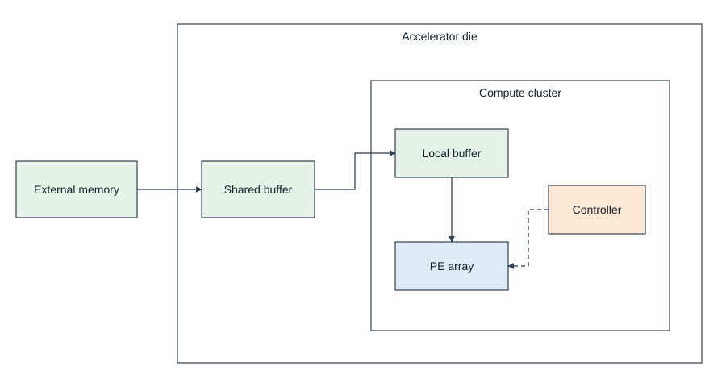
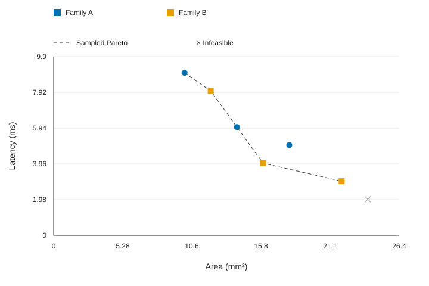
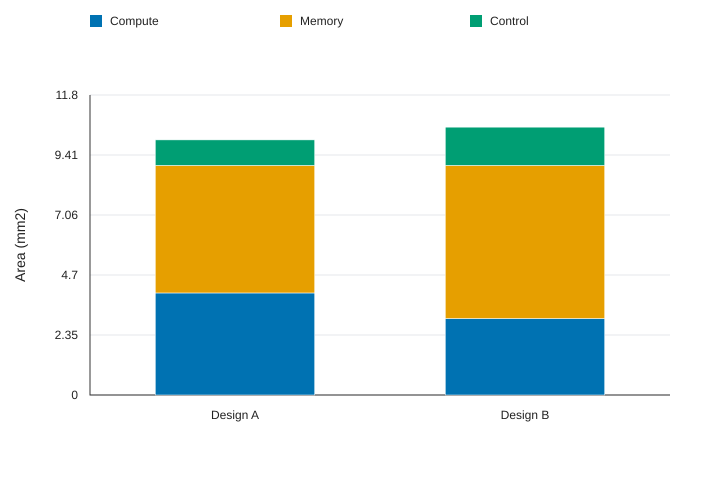

# IC Research Figures

面向 **Codex 的体系结构 / 数字 IC 科研绘图技能**。覆盖系统架构、微架构、PE 阵列、流水/控制、芯片建模、PPA、DSE、roofline 和多精度张量单元研究。

**结构图可人工编辑；数据图可改 Python 和 CSV 后重画。**

## 包含内容

- 一个可调用技能：`$draw-ic-architecture`。
- 六份领域参考：论文图谱、结构图、数据图、可编辑规范、多精度 DSE、检查表。
- 5 组原创模板：system、microarchitecture、pe-array、pipeline、modeling-flow。每组提供 JSON、原生 draw.io 与 SVG。
- Python 生成器、原生对象检查器、DSE/PPA 绘图脚本。
- 2 组 synthetic CSV 数据和预览，明确不代表实测芯片。
- 8 篇已检查图页的一手论文资料：Eyeriss、Bit Fusion、Timeloop、Accelergy、LLMCompass、TRIPS、Gemmini、Aladdin。[论文索引](skills/draw-ic-architecture/references/source-atlas.md)

这是一套技能，不依赖 MCP 服务；不宣称已打包成插件市场安装包。使用标准 SKILL.md 即可复用。

## 安装到项目

在目标项目目录运行（需要 git）：

```bash
git clone https://github.com/Futuresxy/ic-research-figures.git
mkdir -p .agents/skills
cp -R ic-research-figures/skills/draw-ic-architecture .agents/skills/
```

如果目录已存在，先保留本地修改再更新。重开 Codex 会话并确认技能被发现；旧客户端若使用其他技能目录，按其设置复制同一技能文件夹。也可直接让 Codex 读取克隆仓库里的 SKILL.md。

## 直接使用

```text
使用 $draw-ic-architecture：
为我的芯片设计画系统总览和 PE 微架构。
架构图交付可分别编辑模块/连线/文字的 draw.io，
附 SVG 预览，图注独立保存。
没有明确给出的参数请不要编造。
```

```text
使用 $draw-ic-architecture：
读取我的综合结果和 DSE CSV，画面积/功耗分解与 Pareto。
保持简单论文风格，图中不写结论性段落。
交付 Python、CSV、样式配置、PDF/SVG/PNG 和复现命令。
```

## 人工编辑结构图

在 [diagrams.net](https://app.diagrams.net/) 用 File → Open From → Device 打开 `assets/*.drawio`。模块、文字、连线是独立原生对象；容器具有父子关系，连线引用节点 ID。拖动、改字、另存即可。

**人工改过的 draw.io 是最新真源，不要用旧 JSON 覆盖。** JSON 只是初始生成入口。SVG 是预览，普通 SVG 不等同原生 draw.io 编辑源。最终投稿 PDF/SVG 请从最终编辑后的原生图导出。



示例为抽象结构，非某商用芯片复原。

## Python 数据图

Python 3.9+；推荐在虚拟环境安装 Matplotlib：

```bash
python3 -m venv .venv
. .venv/bin/activate
python3 -m pip install -r requirements.txt
python3 skills/draw-ic-architecture/scripts/plot.py \
  skills/draw-ic-architecture/assets/demo_dse.csv \
  --kind dse --out output/demo_dse
python3 skills/draw-ic-architecture/scripts/plot.py \
  skills/draw-ic-architecture/assets/demo_ppa.csv \
  --kind breakdown --style skills/draw-ic-architecture/assets/style.json \
  --out output/demo_ppa
```

默认输出 SVG/PDF/300 dpi PNG 以及 metadata/caption。修改 CSV 后用新输出名重跑；明确想替换时才加 `--force`。没有 Matplotlib 时显式 `--backend svg`，只输出 SVG 与元数据/图注。



此图是 synthetic demo。两个目标均最小化，不可行点不进入前沿，虚线仅连接采样非支配点。



此图是 synthetic demo，单位 mm²；不代表功耗或能量。功耗数据必须单独使用一致单位。

## 结构图生成与检查

```bash
python3 skills/draw-ic-architecture/scripts/diagram.py \
  skills/draw-ic-architecture/assets/system.json --out output/system
python3 skills/draw-ic-architecture/scripts/check.py output/system.drawio
python3 -m unittest discover -s tests -v
```

生成器拒绝默认覆盖，保护人工改图。检查器验证 XML/ID/引用/包含关系/原生节点，但不能证明电路正确或排版无缺陷。

## 能力边界与来源

已提供可运行模板的是结构生成、area–latency DSE 和单指标组件分解；roofline、热图、消融、校准图提供详细规则，需按实际数据扩展脚本。SVG 备用后端固定画布；Matplotlib 后端支持配置栏宽、字体和轴范围。

论文图谱标注实际查看的版本与页码。LLMCompass 实际查阅为 2023 arXiv v1，与 ISCA 2024 最终版分开。论文图片不打包进仓库；所有模板原创，示例数据为构造数据。

